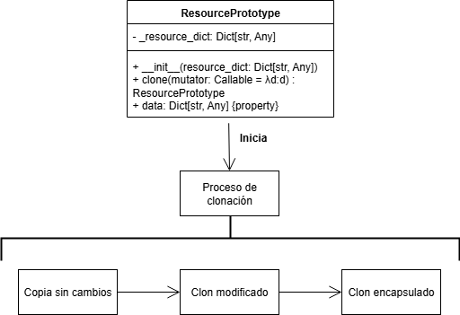

# Fase 1: Exploración y Análisis

## Singleton

Para garantiza una sola instancia, la clase `SingletonMeta` sobrescribe el método `__call__` que se ejecuta al crear una instancia. Se mantiene un diccionario `_instances` de tipo `ConfigSingleton` que almacena la única instancia por clase. Cuando se intenta crear un objeto, se verifica si ya existe en `_instances`. En caso exista, se devuelve la instancia existente, y si no, crea una nueva y la guarda. El `threading.Lock` se emplea para evitar condiciones de carrera en entornos con múltiples hilos. Sin el `lock`, dos hilos podrían ejecutar simultáneamente la verificación y ambos podrían crear instancias separadas, rompiendo el patrón Singleton.

## Factory

La clase `NullResourceFactory` encapsula toda la lógica de creación de recursos `null_resource` de Terraform mediante el método `create()`. De esta manera, se oculta la estructura JSON específica de Terraform que el usuario no necesita conocer. Los `triggers` en `null_resource` de Terraform controlan cuándo el recurso debe recrearse gracias al `UUID` único, el cual garantiza la identidad e idempotencia de cada recurso, y al `timestamp` para registrar la creación del recurso. Esto es útil para tareas como reiniciar servicios o ejecutar scripts de configuración.

## Prototype

El mutator es una función ingresada como argumento que recibe el diccionario clonado y se aplica a sí misma para modificarlo. Si no se proporciona, se usa un `lambda` de identidad para no modificar el clon. Esto permite personalizar cada instancia cambiando nombres, tags, parámetros específicos del clon sin afectar el original. Además, un mismo prototipo puede generar múltiples clones con diferentes mutadores.

## Composite

El proceso de agrupamiento se logra al mantener una lista de módulos `_children` que almacena diccionarios de recursos individuales. Cada hijo es un diccionario independiente con su propia estructura Terraform. Se agregan mediante el método `add()` y se consolida todos los bloques en un único JSON válido en `export()`.
